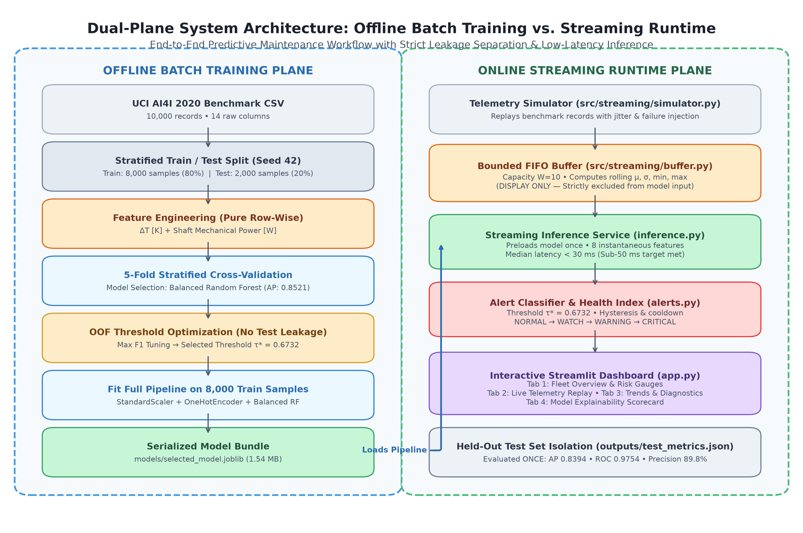

# AI-Powered Predictive Maintenance for IoT Devices

An end-to-end machine learning system for equipment failure prediction, virtual telemetry streaming, sliding-window diagnostic buffering, and interactive monitoring built on the UCI AI4I 2020 Predictive Maintenance benchmark dataset.

---

## 1. Project Overview

Industrial machinery failures cause costly unplanned downtime, safety hazards, and reactive maintenance expenses. Predictive maintenance leverages sensor telemetry to identify conditions preceding failure before catastrophic breakdown occurs.

This project formulates predictive maintenance as a binary classification task: given machine operational parameters, predict the probability that a machine failure will occur. The repository covers the full lifecycle from data validation and leakage-safe preprocessing through ensemble modeling, error analysis, virtual streaming ingestion, and an interactive Streamlit monitoring dashboard.

This is an educational and engineering simulation. It demonstrates how to decouple streaming ingestion from machine learning inference, handle severe class imbalance, and evaluate models without data leakage.

---

## 2. Key Features

- Leakage-Safe Feature Engineering: Derives physical indicators (temperature differential, shaft mechanical power) with strict exclusion of post-hoc failure mode flags and arbitrary identifiers.
- Production-Grade ML Pipeline: Encapsulates median imputation, standard scaling, and one-hot encoding inside Scikit-Learn pipelines to prevent cross-validation leakage.
- Resampled Cross-Validation Comparison: Compares Dummy, Logistic Regression, and Balanced Random Forest candidates across stratified 5-fold cross-validation.
- Out-of-Fold Threshold Optimization: Optimizes the decision threshold on training out-of-fold predictions to maximize F1 score, keeping the test set isolated.
- Model Explainability and Error Audit: Uses permutation feature importance on held-out test data and audits false negatives against underlying mechanical failure modes.
- Virtual Telemetry Streaming: Simulates edge sensor ingestion with physical range checks and sequence tracking.
- Bounded Sliding-Window Buffer: Maintains a FIFO buffer with diagnostic rolling statistics (mean, min, max, standard deviation) for operator visibility. Rolling stats are strictly decoupled from model inputs.
- Low-Latency Inference Service: Preloads the serialized model pipeline into memory, delivering sub-50 ms median inference latency.
- Interactive Streamlit Dashboard: Multi-tab web application providing live simulation stepping, risk gauges, synchronized Plotly sensor charts, and model diagnostics.

---

## 3. Technology Stack

- Language: Python 3.11
- Core Data Science: NumPy 1.26.4, Pandas 2.2.3, SciPy 1.14.1
- Machine Learning: Scikit-Learn 1.5.2, Joblib 1.4.2
- Interactive Dashboard: Streamlit 1.39.0, PyArrow 18.1.0, Plotly 5.24.1
- Testing: Pytest 8.3.3
- Documentation: Markdown, KaTeX, Git

---

## 4. Architecture and Workflow

The system separates batch training from real-time streaming inference:



```
[Batch Training Workflow]
  data/raw/ai4i2020.csv
           |
           v
  Stratified Train/Test Split (80% Train / 20% Test)
           |
           +------------------------------+
           v (Train: N=8,000)             v (Held-out Test: N=2,000)
  5-Fold Stratified Cross-Validation     Isolated Evaluation (Evaluated Once)
           |                                      |
  Threshold Tuning (OOF F1 Max)                   |
           |                                      |
  Fit Final Pipeline on Full Train                |
           |                                      |
           v                                      v
  models/selected_model.joblib          outputs/test_metrics.json

[Streaming Telemetry Runtime]
  [Telemetry Simulator] (Replays AI4I Benchmark Records)
           |
           v
  [Sliding-Window Buffer] (Bounded FIFO, Capacity W=10)
           |  +--> Diagnostic Rolling Statistics (Mean, Min, Max, Std)
           |       (Displayed in Dashboard; NEVER passed to Model)
           v
  [Inference Service] (Single Model Load, 8 Instantaneous Features)
           |
           v
  [Alert Classifier & Demonstration Health Index]
           |
           v
  [Streamlit Dashboard (app.py)] (Overview, Replay, Trends, Diagnostics)
```

For detailed specifications, see the documentation in the `docs/` directory:
- [System Architecture](docs/architecture.md)
- [Data Pipeline and Flow](docs/data_pipeline_and_flow.md)
- [Module and Component Contracts](docs/modules_and_components.md)

---

## 5. Dataset Source and Limitations

- Benchmark: UCI AI4I 2020 Predictive Maintenance Dataset (UCI ID: 601)
- Source: Donated by Stephan Matzka, School of Engineering, HTW Berlin
- Dimensions: 10,000 rows by 14 columns
- Target: `Machine failure` (0 = Normal, 1 = Failure)
- Class Distribution: 9,661 normal records (96.61%) and 339 failure records (3.39%), an imbalance ratio of 28.5 to 1.
- Input Features Used: Machine Type (L, M, H), Air temperature [K], Process temperature [K], Rotational speed [rpm], Torque [Nm], and Tool wear [min].
- Engineered Predictors:
  - Thermal Differential: `temperature_difference = Process temperature [K] - Air temperature [K]`
  - Shaft Mechanical Power: `mechanical_power_w = Torque [Nm] * (Rotational speed [rpm] * 2 * pi / 60)`
- Excluded Columns (Leakage Guards):
  - Identifiers: `UDI` and `Product ID` are excluded as non-generalizable indices.
  - Failure Mode Flags: `TWF`, `HDF`, `PWF`, `OSF`, `RNF` are post-hoc failure attribution flags and are strictly excluded to prevent label leakage.
- Dataset Limitations:
  - The dataset consists of simulated experimental runs rather than continuous factory sensor time series.
  - Tool Wear Failure (TWF) is simulated probabilistically between 200 and 240 minutes of wear while instantaneous sensor readings remain nominal, making TWF difficult to detect with point-in-time classifiers.
  - For full details, see the [Dataset Card](docs/DATA_CARD.md).

---

## 6. Model Approach and Key Evaluation Results

Due to severe class imbalance, accuracy is misleading (a majority classifier scores 96.61% accuracy while finding zero failures). The primary selection metric is **Average Precision (PR-AUC)**.

### Model Candidates Comparison (5-Fold CV on 8,000 Training Samples)

| Model Candidate | Mean CV Avg Precision | Std CV Avg Precision | OOF ROC-AUC | OOF F1-Score | OOF Recall | OOF Precision |
| :--- | :---: | :---: | :---: | :---: | :---: | :---: |
| **Random_Forest_Balanced** (Selected) | **0.8521** | 0.0328 | **0.9762** | **0.7365** | 0.8044 | 0.6791 |
| Logistic_Regression_Balanced | 0.4835 | 0.0254 | 0.9187 | 0.2738 | 0.8229 | 0.1642 |
| Dummy_Majority (Floor Baseline) | 0.0339 | 0.0002 | 0.5000 | 0.0000 | 0.0000 | 0.0000 |

### Threshold Selection
The decision threshold was tuned strictly on training out-of-fold (OOF) predicted probabilities to maximize F1 score, yielding `tau* = 0.6732`. The test set was never used to select or tune thresholds.

### Held-Out Test Set Performance (2,000 Samples, 68 Failures)

| Metric | Baseline Threshold (0.50) | Selected Threshold (0.6732) |
| :--- | :---: | :---: |
| **Average Precision (PR-AUC)** | 0.8394 | 0.8394 |
| **ROC-AUC** | 0.9754 | 0.9754 |
| **F1-Score** | 0.7317 | **0.8346** |
| **Precision** | 0.6250 | **0.8983** |
| **Recall (Sensitivity)** | 0.8824 | 0.7794 |
| **True Positives (TP)** | 60 | 53 |
| **True Negatives (TN)** | 1,896 | 1,926 |
| **False Positives (FP)** | 36 | **6** |
| **False Negatives (FN)** | 8 | 15 |

At the selected threshold of 0.6732, false positives dropped from 36 to 6, increasing precision to 89.8% while maintaining 77.9% recall. For deeper analysis, see the [Model Card](docs/MODEL_CARD.md).

---

## 7. Visual Evidence and System Showcase

This section compiles visual evidence from dataset exploration, model evaluation, the live dashboard, and terminal telemetry streaming.

### System Architecture


*Figure 1: Dual-plane architecture separating offline batch training and leakage-safe preprocessing from real-time streaming runtime and bounded FIFO buffering.*

### Dataset and Exploratory Analysis


*Figure 2: Binary target distribution in the UCI AI4I 2020 dataset showing severe class imbalance (96.61% normal vs. 3.39% failure).*


*Figure 3: Correlation heatmap across continuous sensor channels and failure indicators.*


*Figure 4: First-principles physical derivations for thermal differential and shaft mechanical power alongside strict leakage exclusion boundaries.*

### Model Evaluation and Explainability


*Figure 5: Held-out test set confusion matrix (N=2,000) at optimized threshold tau* = 0.6732, achieving 89.83% precision, 77.94% recall, and 0.31% false positive rate.*


*Figure 6: Permutation feature importance on test data (scoring: average precision), identifying rotational speed and thermal differential as dominant predictors.*


*Figure 7: Forensic audit of test false negatives and false positives broken down across mechanical failure modes.*

### Streamlit Dashboard
The interactive Streamlit dashboard (`app.py`) provides an operator interface with 4 dedicated functional tabs:

#### Fleet and Machine Overview
Real-time operational status badge (NORMAL, WATCH, WARNING, CRITICAL), failure probability gauge bar, synthetic demonstration health index, cumulative processed sample counts, and instantaneous sensor metrics:


#### Live Telemetry Simulation
Interactive stepping controls (Next Sample, Run Batch of 5, 10, or 25), replay ordering toggle (sequential vs. reproducibly shuffled), dynamic buffer capacity slider, and recent event history:


#### Sensor Trends and Buffer Diagnostics
Synchronized Plotly charts tracking Spindle Dynamics (Speed vs. Torque), Thermal Profile (Air, Process, Delta T), Tool Wear vs. Mechanical Power, and Model Risk Trajectory alongside rolling window summary statistics:


#### Model Diagnostics and Limitations
Held-out test scorecard, permutation feature importance bar chart, empirical inference latency benchmarks, and transparent discussion of scientific limitations:


### Virtual Telemetry Demonstration
Execution of the streaming simulator CLI (`python main.py --samples 5`):

```text
==========================================================================================
  IoT Telemetry Streaming & Low-Latency Inference Demonstration (Phase 6)
==========================================================================================
Total Stream Samples: 5 | Buffer Capacity: 10 | Decision Threshold: 0.6732
Simulation Mode: Replaying AI4I benchmark records (Software simulation only)
------------------------------------------------------------------------------------------
Seq   | Type | Temp Diff [K] | Speed [rpm] | Torque [Nm] | P(Fail)  | Alert    | HI (%)  | Latency  
------------------------------------------------------------------------------------------
1     | M    | 10.50         | 1551        | 42.8        | 0.0019   | NORMAL   | 99.8    | 141.83 ms
2     | L    | 10.50         | 1408        | 46.3        | 0.0141   | NORMAL   | 98.6    | 32.15 ms
3     | L    | 10.40         | 1498        | 49.4        | 0.0377   | NORMAL   | 96.2    | 20.32 ms
4     | L    | 10.40         | 1433        | 39.5        | 0.0076   | NORMAL   | 99.2    | 21.68 ms
5     | L    | 10.50         | 1408        | 40.0        | 0.0076   | NORMAL   | 99.2    | 29.98 ms
------------------------------------------------------------------------------------------
Final Buffer Rolling Diagnostics (Last 10 Records - For Operator Display Only):
  - Air temperature [K]: Mean=298.16, Min=298.1, Max=298.2, Std=0.0548
  - Process temperature [K]: Mean=308.62, Min=308.5, Max=308.7, Std=0.0837
  - Rotational speed [rpm]: Mean=1459.6, Min=1408.0, Max=1551.0, Std=62.9706
  - Torque [Nm]: Mean=43.6, Min=39.5, Max=49.4, Std=4.2232
  - Tool wear [min]: Mean=4.8, Min=0.0, Max=9.0, Std=3.4928
------------------------------------------------------------------------------------------
Performance Measurement (Local Inference Latency):
  - Sample Count: 5
  - Median (P50) Latency: 29.977 ms
  - 95th Percentile (P95): 119.891 ms
  - Mean Latency:         49.190 ms (Min: 20.321 ms, Max: 141.827 ms)
  - Alert Distribution:   {'NORMAL': 5}
==========================================================================================
```

---

## 8. Installation and Quickstart

### Prerequisites
- Python 3.11 installed.
- Git installed.

### Step 1: Clone the Repository
```bash
git clone https://github.com/AkashDas-AI/Ai-Powered-Predictive-Maintenance-IoT.git
cd Ai-Powered-Predictive-Maintenance-IoT
```

### Step 2: Create and Activate Virtual Environment

On Windows (PowerShell):
```powershell
py -3.11 -m venv .venv
.\.venv\Scripts\Activate.ps1
```

On Linux or macOS:
```bash
python3.11 -m venv .venv
source .venv/bin/activate
```

### Step 3: Install Dependencies
```bash
python -m pip install --upgrade pip
python -m pip install -r requirements.txt
```

Verify dependency consistency:
```bash
python -m pip check
```
Expected output: `No broken requirements found.`

---

## 9. Verification and Execution Commands

### Launch the Streamlit Dashboard
```bash
streamlit run app.py
```
Or with explicit virtual environment Python:
```powershell
.\.venv\Scripts\python.exe -m streamlit run app.py
```
Open `http://localhost:8501` in your browser.

### Run CLI Telemetry Streaming Demo
```bash
# Default (25 samples, window 10)
python main.py

# Custom stream count and buffer capacity
python main.py --stream --samples 50 --window 10
```

### Run Complete Test Suite (56 tests)
```bash
pytest tests/ -v
```

### Run Model Training and Diagnostics Workflows
```bash
# Rerun cross-validation training pipeline
python src/train.py

# Rerun permutation importance and error analysis
python src/diagnostics.py
```

---

## 10. Important Limitations and Future Scope

### Project Limitations
1. Software Simulation: This is an educational demonstration using benchmark data. It does not connect to physical factory PLCs or industrial control loops.
2. Independent Experimental Runs: The dataset consists of independent static trials rather than continuous degradation time series of a physical cutting tool.
3. Demonstration Health Index: The Health Index formula `100 * (1 - P(failure))` is an inverted model probability. It is not an engineered or physics-certified Remaining Useful Life (RUL) estimator.
4. Tool Wear Failure Ceiling: Instantaneous sensor values remain normal during TWF events. High-frequency vibration or acoustic sensing is required for physical tool wear detection.
5. Random Failures (RNF): Simulated as an independent random trial (0.1% probability), making it statistically unviable for predictive modeling.

### Future Scope
- Sequence Prognostics: Implement LSTM and Transformer regression models on NASA C-MAPSS turbofan run-to-failure degradation trajectories.
- Multimodal Sensing: Ingest high-frequency vibration and accelerometer data to overcome the tool wear detection ceiling.
- Unsupervised Novelty Detection: Add Autoencoder or Isolation Forest pipelines to catch operational drift.
- Edge Containerization: Package inference runtime into Docker containers with ONNX Runtime for edge IoT deployment.

---

## 11. License

This project is licensed under the MIT License. See the [LICENSE](LICENSE) file for the complete license text:

```text
MIT License
Copyright (c) 2026 Akash Das
```

*Note on Third-Party Data: The UCI AI4I 2020 dataset is distributed under Creative Commons Attribution 4.0 International (CC BY 4.0). The MIT License covers project code, pipeline architecture, and documentation, and does not override original dataset licensing.*

---

## 12. References and Dataset Attribution

- Stephan Matzka, "Explainable Artificial Intelligence for Predictive Maintenance Applications," Third International Conference on Artificial Intelligence for Industries (AI4I), 2020.
- UCI Machine Learning Repository: AI4I 2020 Predictive Maintenance Dataset (https://archive.ics.uci.edu/dataset/601/ai4i+2020+predictive+maintenance+dataset).
- Scikit-Learn: Machine Learning in Python, Pedregosa et al., JMLR 12, pp. 2825-2830, 2011.
- Streamlit Documentation: https://docs.streamlit.io/
- Project Implementation History: See [Execution Log](docs/execution_log.md) and [Project Plan](docs/PROJECT_PLAN.md).
