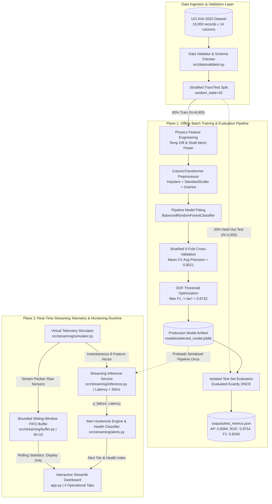

# System Architecture: AI-Powered Predictive Maintenance for IoT Devices

This document specifies the system architecture, component topologies, and runtime pipelines for the **AI-Powered Predictive Maintenance for IoT Devices** platform.

---

## 1. High-Level Architecture Overview

The system is architected as two decoupled sub-systems:
1. **Offline Training & Validation Pipeline**: A reproducible batch workflow for data validation, stratified splitting, leakage-safe feature engineering, cross-validated model selection, and out-of-fold threshold optimization.
2. **Real-Time Streaming & Monitoring Runtime**: A lightweight, memory-resident inference engine that simulates edge IoT sensor streaming, sliding-window buffering, low-latency scoring, and interactive web dashboard visualization.

```
========================================================================================================================
                                      HIGH-LEVEL SYSTEM ARCHITECTURE OVERVIEW
========================================================================================================================

  [ PLANE 1: OFFLINE BATCH TRAINING & EVALUATION PIPELINE ]
  +------------------------------------------------------------------------------------------------------------------+
  | 1. Raw Dataset Ingestion: UCI AI4I 2020 Predictive Maintenance Benchmark (10,000 samples x 14 columns)           |
  |    |-- Validation Layer (src/data/loader.py, validator.py, schema.py): Null/Duplicate/Range Assertions          |
  |    \-- Target: Machine failure (96.61% Normal [0] vs. 3.39% Failure [1] | Imbalance Ratio: 28.5 to 1)            |
  |                                                                                                                  |
  | 2. Deterministic Stratified Split (src/features/split.py): random_state=42                                       |
  |    |-- Training Partition: N = 8,000 (80% | 271 Failures) ---------------------+                                 |
  |    \-- Held-Out Test Partition: N = 2,000 (20% | 68 Failures) -------------+   | (Fold/Test Isolation Guard)     |
  |                                                                           |   |                                  |
  | 3. Domain Physics Feature Engineering (src/features/engineering.py)       |   |                                  |
  |    |-- Thermal Differential: Delta T = Process Temp [K] - Air Temp [K]     |   |                                  |
  |    \-- Shaft Mechanical Power: P_mech = Torque [Nm] * (RPM * 2*pi / 60)    |   |                                  |
  |                                                                           |   |                                  |
  | 4. Preprocessing & Model Pipeline (src/features/preprocessing.py)         |   |                                  |
  |    |-- ColumnTransformer: SimpleImputer(median) + StandardScaler (Numeric)|   |                                  |
  |    |                      SimpleImputer(frequent) + OneHotEncoder (Type)  |   |                                  |
  |    |-- Classifier: BalancedRandomForestClassifier(n_estimators=100)       |   |                                  |
  |    \-- Feature Contract: 8 Instantaneous Inputs (Prohibited: UDI,         |   |                                  |
  |                          Product ID, Target, and 5 Failure Flags)         |   |                                  |
  |                                                                           |   |                                  |
  | 5. Model Selection & Threshold Optimization (src/train.py)                |   |                                  |
  |    |-- Stratified 5-Fold Cross-Validation on Train:                       |   |                                  |
  |    |   Balanced Random Forest (Mean CV AP = 0.8521, ROC-AUC = 0.9786)     |   |                                  |
  |    \-- Out-of-Fold Threshold Tuning: Maximize F1 without test leak        |   |                                  |
  |        Optimal Decision Threshold: tau* = 0.6732 (OOF F1 = 0.7984)        |   |                                  |
  |                                                                           |   |                                  |
  | 6. Production Model Serialization: models/selected_model.joblib <---------+---+                                  |
  |                                                                           |                                      |
  | 7. Single Held-Out Evaluation (src/evaluate.py, diagnostics.py): <--------+                                      |
  |    |-- Evaluated ONCE at tau* = 0.6732 (outputs/test_metrics.json, confusion_matrix.csv)                         |
  |    \-- Results: AP: 0.8394 | ROC-AUC: 0.9754 | F1: 0.8346 | Precision: 89.83% | Recall: 77.94% | FPR: 0.31%    |
  +--------------------------------------------+---------------------------------------------------------------------+
                                               | Pipeline Serialized (.joblib)
                                               v Preloaded ONCE into Memory
  [ PLANE 2: REAL-TIME STREAMING TELEMETRY & MONITORING RUNTIME ]
  +--------------------------------------------+---------------------------------------------------------------------+
  |                                                                                                                  |
  |   [Virtual Telemetry Simulator] (src/streaming/simulator.py)                                                     |
  |   - Replays benchmark test partition records sequentially or with reproducible seeded shuffle                    |
  |   - Generates simulated point-in-time sensor packets with physical range and sensor validity assertions          |
  |                                    | Stream Packet: {seq_id, timestamp, Type, 5 raw sensor readings}             |
  |                                    v                                                                             |
  |   [Bounded Sliding-Window Buffer] (src/streaming/buffer.py)                                                      |
  |   - Thread-safe FIFO circular buffer (capacity W = 10, collections.deque) with deep-copy immutability           |
  |   - Computes rolling window statistics (mean, min, max, sample std ddof=1) across numerical channels            |
  |   * DECOUPLING GUARD: Rolling statistics are for dashboard display only; NEVER passed to model feature matrix.  |
  |                                    | Instantaneous 8-Feature Vector (Type, 5 Raw Sensors, Delta T, P_mech)        |
  |                                    v                                                                             |
  |   [Streaming Inference Service] (src/streaming/inference.py)                                                     |
  |   - Low-latency inference wrapper preloading serialized pipeline in memory                                       |
  |   - Deterministic row-wise physics calculation; asserts all prohibited columns excluded                         |
  |   - Evaluates predict_proba() -> failure probability | Latency benchmark: < 30 ms median (sub-50 ms target met)  |
  |                                    | Inference Payload: {probability, alert_state, health_index, latency_ms}     |
  |                                    v                                                                             |
  |   [Alert Engine & Health Classifier] (src/streaming/alerts.py)                                                   |
  |   - Operational Alert Tiers: NORMAL (<0.30) | WATCH (0.30-0.50) | WARNING (0.50-0.6732) | CRITICAL (>=0.6732)   |
  |   - Hysteresis logic and cooldown counters to suppress alert fatigue                                             |
  |   - Demonstration Health Index = 100.0 * (1.0 - P(failure))                                                      |
  |                                    |                                                                             |
  |                                    v                                                                             |
  |   [Interactive Streamlit Monitoring Dashboard] (app.py)                                                          |
  |   - Orchestrated by session state manager (src/dashboard/state.py) with defensive table fallbacks                |
  |   - Tab 1: Fleet & Machine Overview (Operational badge, failure probability gauge, instantaneous sensor cards)   |
  |   - Tab 2: Live Telemetry Simulation (Step single, batch runner 5/10/25, replay ordering, event history)         |
  |   - Tab 3: Sensor Trends & Buffer Diagnostics (Synchronized Plotly charts, active rolling statistics)            |
  |   - Tab 4: Model Diagnostics & Scorecard (Held-out test metrics, permutation importance, scientific limits)      |
  |                                                                                                                  |
  +------------------------------------------------------------------------------------------------------------------+
========================================================================================================================
```

### Component Flowchart



---

## 2. Component Subsystems and Design Principles

### 1. Ingestion & Validation Subsystem
- **Modules**: `src/data/loader.py`, `src/data/validator.py`, `src/data/schema.py`
- **Design Principle**: Fail-early schema validation. Ingests raw data via project-root relative resolution, performs strict type and value range checks, asserts zero nulls, and verifies target column binary integrity before data reaches feature engineering.

### 2. Feature Engineering & Preprocessing Subsystem
- **Modules**: `src/features/engineering.py`, `src/features/preprocessing.py`, `src/features/schema.py`, `src/features/split.py`
- **Design Principle**: Strict leakage prevention and immutability.
  - Excludes identifiers (`UDI`, `Product ID`), the target (`Machine failure`), and post-hoc failure mode flags (`TWF`, `HDF`, `PWF`, `OSF`, `RNF`).
  - Engineers physically grounded features:
    $$\Delta T = T_{\text{process}} - T_{\text{air}}$$
    $$P_{\text{mech}} = \tau \cdot \left(\omega_{\text{rpm}} \cdot \frac{2\pi}{60}\right)$$
  - Encapsulates transformations within a Scikit-Learn `ColumnTransformer` to ensure fitting occurs strictly on training folds.

### 3. Training & Evaluation Subsystem
- **Modules**: `src/train.py`, `src/evaluate.py`, `src/diagnostics.py`
- **Design Principle**: Asymmetric risk evaluation and test set isolation.
  - Compares candidate models via stratified 5-fold cross-validation using **Average Precision (PR-AUC)** as the primary selection criterion.
  - Balances class weights (`class_weight='balanced'`) to address the 28.5:1 class imbalance.
  - Tunes decision threshold ($\tau^* = 0.6732$) strictly on training out-of-fold predictions.
  - Evaluates the held-out test set (N=2,000) exactly once, followed by permutation feature importance and forensic false-negative auditing.

### 4. Streaming Runtime Subsystem
- **Modules**: `src/streaming/simulator.py`, `src/streaming/buffer.py`, `src/streaming/inference.py`, `src/streaming/alerts.py`
- **Design Principle**: Decoupled, stateful edge simulation with low latency.
  - Simulates edge sensor packets with physical range checks.
  - Maintains a bounded sliding-window FIFO buffer for operator rolling statistics.
  - Preloads model pipeline once in memory, delivering sub-50 ms median inference latency.
  - Maps failure probabilities into 4 actionable operational alert tiers.

### 5. Presentation Subsystem
- **Modules**: `app.py`, `src/dashboard/state.py`, `src/dashboard/charts.py`, `src/dashboard/metrics.py`
- **Design Principle**: Session state idempotency and reactive safety.
  - Stores application state in `DashboardSession`, ensuring that Streamlit script re-executions do not advance telemetry or trigger duplicate scoring without explicit user button clicks.
  - Employs defensive rendering fallbacks from `st.dataframe()` to `st.table()` to guarantee resilience across diverse host environments.

---

## 3. Detailed Data Flow and Interface Contracts

For complete tracing of data transformations through every stage, see [Data Pipeline & Flow](data_pipeline_and_flow.md). For formal class and function signatures, see [Modules & Components](modules_and_components.md).
